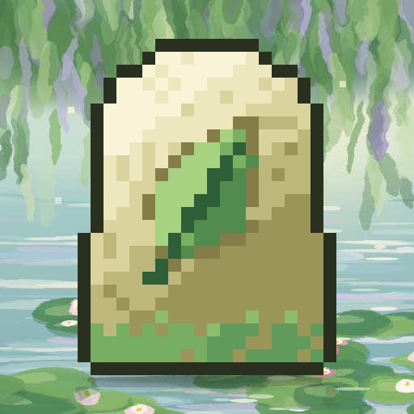

# LeviStone



English | [中文](README.zh.md)

A runtime for running [Endstone](https://github.com/EndstoneMC/endstone) plugins on [LeviLamina](https://github.com/LiteLDev/LeviLamina)

## Installation

Run this in the folder of your Bedrock Dedicated Server with LeviLamina installed:

```bash
pip install levistone --target mods/EndstoneRuntime
```
LeviStone is a LeviLamina mod named `EndstoneRuntime` (the Endstone runtime it ships), so it is installed to `mods/EndstoneRuntime`, the folder for that mod.

You can also add == after levistone to install a specific version.  
For example, to install version 0.11.15:
```bash
pip install levistone==0.11.15 --target mods/EndstoneRuntime
```
You can find versions on [PyPI](https://pypi.org/project/levistone/#history).

If you want to install LeviStone older than 0.11.15, you should modify the `mods` directory to `plugins`.  
For example, to install version 0.11.14:
```bash
pip install levistone==0.11.14 --target plugins/EndstoneRuntime
```

Using Docker? Try [docker-levistone-server](https://github.com/LiteLDev/docker-levistone-server)

## FAQ

### Can I run Endstone native plugins?

No, LeviStone only supports plugins written in Python.

### Why are some Endstone versions not supported?

LeviLamina only supports one version from each Minecraft protocol version, while Endstone supports multiple versions.

### How do I know which version I should install?

Check the [LeviLamina supported versions](https://docs.levimc.org/LeviLamina/versions/) and the [Endstone release page](https://github.com/EndstoneMC/endstone/releases).

## License

Apache-2.0. LeviStone is based on [Endstone](https://github.com/EndstoneMC/endstone) by The Endstone Project.
